## 💖 About this profile

This is my neon galaxy-inspired developer profile design.

### 💻 Frontend
HTML · CSS · JavaScript

### 🎨 UI / UX
Figma · FigJam · Google Stitch · Uizard · Canva · Maze · Relume · Khroma

### 🤖 AI Tools
ChatGPT · Lovable · Bolt.new · Cursor · v0 · Adobe Firefly

### 🚀 Projects
- **HealthyBites** — healthy food delivery website using HTML, CSS and JavaScript.
- **BookNest** — second-hand bookstore web app using PHP, MySQL, HTML, CSS and JavaScript.

> Note: The large SVG is a visual profile banner/mockup. Its contribution squares and stats are illustrative graphics, not live GitHub data. GitHub README does not run interactive JavaScript or true 3D effects inside SVG.
